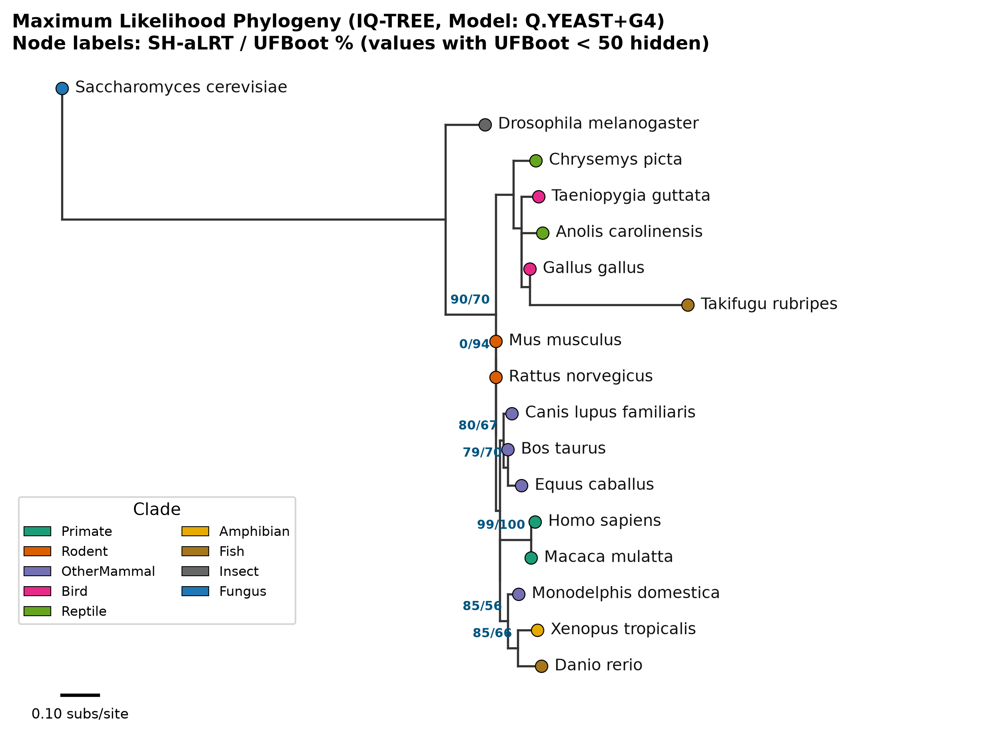

# Comparative Sequence and Phylogenetic Analysis of Cytochrome *c* Across Vertebrate Species

[](https://www.python.org/downloads/release/python-3110/)
[](#)
[](#)

## 1. Project Summary

Cytochrome *c* (gene *CYCS* in vertebrates) is a small (~105 aa), nuclear-encoded mitochondrial electron-transfer protein essential for cellular respiration and apoptosis. This computational biology project collects, curates, aligns, and analyzes somatic cytochrome *c* protein sequences across **15 vertebrate species** and **2 non-vertebrate outgroups** (17 species total) from UniProtKB. We quantify per-position conservation, measure pairwise similarity and molecular-clock behavior, reconstruct Neighbor-Joining and Maximum Likelihood phylogenies, and evaluate how closely sequence-derived trees match the accepted vertebrate species tree.

- **Team:** Maaz Mahmood (23L-0728), Qasim Shakil (23I-0687)
- **Instructor:** Ms. Rushda Muneer
- **Institution:** National University of Computer and Emerging Sciences (FAST-NUCES), Department of Computer Science, Lahore, Pakistan

---

## 2. Key Results at a Glance

- **Extreme conservation (RQ1):** **67 / 105 (63.81%)** vertebrate columns are strictly invariant and **83 / 105 (79.05%)** are ≥ 90% conserved (mean Shannon entropy **0.274 bits**). Across all 17 species including *D. melanogaster* and *S. cerevisiae*, **52 / 67 (77.6%)** of vertebrate-invariant sites remain strictly invariant.
- **Functional anchors (RQ2):** All heme ligands (UniProt `C15, C18, H19, M81`; classical `C14, C17, H18, M80`), the 11-aa invariant Met80 loop (`NPKKYIPGTKM`, UniProt 71–81), heme-pocket H-bond/packing residues, regulatory phosphosites (`Y49, Y98`), and the pathogenic Thrombocytopenia 4 variant site `G42S` (cl. `G41`) are **100% invariant** across all 17 species.
- **Alignment robustness:** Clustal Omega 1.2.4 and MUSCLE 5.3 agree on **98.10%** of vertebrate columns (99.87% of residue pairs) and **96.33%** of all-17 columns, with zero internal gaps.
- **Similarity gradient & molecular clock (RQ3):** Pairwise identity decreases monotonically with evolutionary distance — within mammals (**93.61%**) > mammal–bird (**90.89%**) > mammal–fish (**80.78%**) > vertebrate–yeast (**61.41%**). Human-vs-X identity correlates strongly with divergence time (Spearman `rho = −0.958`; Poisson clock OLS `R² = 0.815`, slope `0.352` subs/site/Gyr). *Mus musculus* and *Rattus norvegicus* are **100.0% identical**.
- **Phylogenetic resolution & honest limitations (RQ4):** Only **19 / 105** vertebrate columns are parsimony-informative. Primary ML (IQ-TREE `Q.YEAST+G4`) strongly supports Vertebrata (`89.9 / 70`) and Primates (`98.9 / 100`), recovering **5 / 14** reference clades (unrooted RF = 19; dropping to **12** when 7 unsupported branches are collapsed; NJ Poisson recovers 8/14, RF = 13). Accelerated evolution in *Takifugu rubripes* (`+0.136` clock residual) induces long-branch attraction.
- **Hypothesis verdict:** **Partially supported** (strongly supported for pairwise similarity; limited resolution for full vertebrate phylogeny).



---

## 3. Quick Start

```bash
# 1. Create and activate the conda/mamba environment (Linux / WSL2 Ubuntu)
mamba env create -f environment.yml
conda activate cytc

# 2. Verify toolchain
make check

# 3. Reproduce the full pipeline (use all-offline to skip live UniProt downloads)
make all-offline   # or: make all

# 4. Run the full test suite (all 9 phases)
pytest -q

# 5. Build submission zip (dist/cytc_project_submission.zip)
make package
```

---

## 4. Repository Layout

```text
cytc-phylo/
├── AGENTS.md / CLAUDE.md        # Master project specification
├── README.md                    # This file
├── PROGRESS.md                  # Phase completion tracker
├── environment.yml              # Conda environment definition
├── environment.lock.yml         # Pinned environment export
├── Makefile                     # Reproducible phase & packaging targets
├── config/
│   ├── config.yaml              # Centralized parameters & thresholds
│   ├── species.csv              # Curated 17-species table
│   └── reference_species_tree.nwk
├── phases/                      # Phase-by-phase protocol guides (0–8)
├── data/
│   ├── raw/                     # Read-only UniProt downloads & candidate audit
│   └── processed/               # Curated FASTAs, id_map.csv, dataset_manifest.json
├── results/
│   ├── alignments/              # Clustal Omega, MUSCLE v5, primary & trimmed MSAs
│   ├── conservation/            # Per-position metrics, regions, summary.md
│   ├── similarity/              # 6 symmetric matrices, pairwise_long, crosscheck
│   ├── trees/                   # NJ, FastTree, IQ-TREE, sensitivity RF, iTOL exports
│   ├── interpretation/          # UniProt annotations, RQ1–RQ4 answers, limitations
│   ├── figures/                 # 300 dpi PNG + SVG figures
│   └── tables/                  # CSV summary tables & reproducibility check
├── report/
│   ├── final_report.md          # Complete research report
│   ├── figures/                 # Consolidated report figures (Fig01–Fig12)
│   ├── tables/                  # Consolidated report tables (T1–T9)
│   ├── asset_manifest.csv       # Checksums of all report assets
│   ├── citation_audit.md        # Bibliographic verification of proposal references
│   ├── deliverables_checklist.md
│   └── software_versions.md
├── src/cytc/                    # Shared config/logging/path utilities
├── scripts/                     # Numbered pipeline scripts (00–80)
├── tests/                       # Pytest verification suites (test_phase0–8)
└── dist/                        # Packaged submission archive
```

---

## 5. Phase Roadmap & Outputs Map

| Phase | Guide | Status | Primary Deliverable / Output |
| --- | --- | --- | --- |
| 0 Setup | [PHASE_0_setup.md](phases/PHASE_0_setup.md) | [x] | Environment & toolchain verification (`scripts/00_check_env.py`) |
| 1 Data Collection | [PHASE_1_data_collection.md](phases/PHASE_1_data_collection.md) | [x] | `data/raw/cytc_raw.fasta`, `results/tables/dataset_provenance.csv` |
| 2 Sequence Preparation | [PHASE_2_sequence_preparation.md](phases/PHASE_2_sequence_preparation.md) | [x] | `data/processed/cytc_curated.fasta`, `id_map.csv`, `dataset_manifest.json` |
| 3 Alignment | [PHASE_3_alignment.md](phases/PHASE_3_alignment.md) | [x] | `results/alignments/primary_all.fasta`, `primary_vert.fasta`, `alignment_notes.md` |
| 4 Conservation | [PHASE_4_conservation.md](phases/PHASE_4_conservation.md) | [x] | `results/conservation/regions.csv`, logos, `per_position_{vert,all}.csv` |
| 5 Similarity | [PHASE_5_similarity.md](phases/PHASE_5_similarity.md) | [x] | `results/similarity/*_matrix.csv`, `pairwise_long.csv`, `identity_to_human.csv` |
| 6 Phylogenetics | [PHASE_6_phylogenetics.md](phases/PHASE_6_phylogenetics.md) | [x] | `results/trees/iqtree/cytc_all.treefile`, NJ/FastTree, iTOL exports |
| 7 Interpretation | [PHASE_7_interpretation.md](phases/PHASE_7_interpretation.md) | [x] | `results/interpretation/research_questions_answers.md`, `limitations.md` |
| 8 Reporting | [PHASE_8_reporting.md](phases/PHASE_8_reporting.md) | [x] | `report/final_report.md`, `dist/cytc_project_submission.zip` |

---

## 6. Software Versions & Data Licensing

- **Toolchain:** Python 3.11.18, Biopython 1.88, pandas 3.1.1, NumPy 2.4.6, SciPy 1.17.1, Matplotlib 3.11.2, seaborn 0.13.2, DendroPy 5.1.3, Logomaker 0.8.7, Clustal Omega 1.2.4, MUSCLE 5.3, IQ-TREE 3.1.4, FastTree 2.2.0, trimAl 1.5.rev1 (full list in `report/software_versions.md` and `environment.lock.yml`).
- **Data Sources & Licensing:** Protein sequences and annotations were retrieved from **UniProtKB** (CC BY 4.0 license; The UniProt Consortium, 2023). Taxonomic metadata follow **NCBI Taxonomy** (public domain).

---

## 7. Summary of Limitations

This is a single-gene computational analysis (~105 aa, 19 parsimony-informative vertebrate sites), so shallow splits and identical sequences (*M. musculus* / *R. norvegicus*) cannot be resolved, and fast-evolving lineages (*Takifugu rubripes*) introduce long-branch attraction. Full discussion appears in `results/interpretation/limitations.md` and Section 7 of `report/final_report.md`.
