# Comparative Sequence and Phylogenetic Analysis of Cytochrome *c* Across Vertebrate Species

**Team Members:** Maaz Mahmood (23L-0728), Qasim Shakil (23I-0687)  
**Instructor:** Ms. Rushda Muneer  
**Institution:** National University of Computer and Emerging Sciences (FAST-NUCES), Department of Computer Science, Lahore, Pakistan  
**Date:** 2026-11-21  

---

## Abstract

Cytochrome *c* (*CYCS*) is a small (~105 aa), nuclear-encoded mitochondrial electron-transfer protein whose strong functional constraints have made it a foundational model in molecular evolution. In this computational study, we curated somatic cytochrome *c* protein sequences from 15 vertebrate species spanning mammals, birds, reptiles, amphibians, and teleost fishes, alongside 2 non-vertebrate outgroups (*Drosophila melanogaster* and *Saccharomyces cerevisiae*; 17 sequences total) from UniProtKB. Multiple sequence alignments generated independently with Clustal Omega 1.2.4 and MUSCLE 5.3 showed high concordance (98.10% shared informative columns in vertebrates; 96.33% across all 17 species). Conservation analysis revealed extreme sequence constraint: **67 / 105 (63.81%)** vertebrate positions are strictly invariant, **83 / 105 (79.05%)** are >= 90% conserved, and **52 / 67 (77.6%)** vertebrate-invariant sites remain strictly invariant in fly and yeast, including all heme-binding ligands (Cys15, Cys18, His19, Met81 in human UniProt numbering; classical Cys14, Cys17, His18, Met80). Pairwise sequence identity declined monotonically with approximate divergence time (human-vs-X Spearman rho = −0.958; Poisson molecular-clock OLS R² = 0.815, slope = 0.352 substitutions/site/Gyr), from 100.0% (*Mus musculus* vs. *Rattus norvegicus*) and 99.05% (human vs. macaque) down to 62.50% (human vs. yeast). However, maximum-likelihood (IQ-TREE `Q.YEAST+G4`), Neighbor-Joining, and FastTree phylogenies recovered only **4–9 / 14** clades of the accepted vertebrate species tree (ML unrooted RF = 19, dropping to 12 after collapsing 7 unsupported branches), because only 19 vertebrate positions are parsimony-informative and accelerated divergence in *Takifugu rubripes* induces long-branch attraction. Thus, our hypothesis is **partially supported**: cytochrome *c* strongly reflects evolutionary distance in pairwise similarity, yet a single ultra-conserved 105-aa protein lacks sufficient signal to resolve the full vertebrate tree.

---

## 1. Introduction

Cytochrome *c* is a water-soluble, heme-*c*-containing metalloprotein localized in the mitochondrial intermembrane space, where it shuttles electrons from ubiquinol-cytochrome *c* reductase (Complex III) to cytochrome *c* oxidase (Complex IV) and acts as a key cytosolic trigger of intrinsic apoptosis via Apaf-1 binding. Because disruption of either electron transport or heme coordination is deleterious, cytochrome *c* evolves slowly and retains recognizable homology across more than a billion years of eukaryotic evolution.

This study evaluates the evolutionary conservation, pairwise divergence, and phylogenetic resolving power of somatic cytochrome *c* across representative vertebrates by addressing four research questions:
- **RQ1:** How conserved is cytochrome *c* across the selected vertebrate species?
- **RQ2:** Which amino-acid positions or regions are highly conserved?
- **RQ3:** How does sequence similarity vary between closely and distantly related species?
- **RQ4:** Can cytochrome *c* sequence information be used to infer meaningful phylogenetic relationships?

Throughout this report, residue coordinates are reported in **both** human UniProt numbering (initiator Met1 = 1; 105 aa total) and classical horse-heart numbering (initiator Met removed; classical = UniProt − 1 for vertebrates).

---

## 2. Background and Related Work

Comparative studies of cytochrome *c* shaped the earliest decades of molecular phylogenetics. Fitch (1976) [1] analyzed eukaryotic cytochrome *c* sequences to test the molecular clock and introduced the covarion concept, demonstrating that amino-acid substitutions are non-randomly distributed across structurally constrained and variable sites. Syvanen, Hartman, and Stevens (1989) [2] compared 26 angiosperm cytochrome *c* sequences against 27 vertebrate sequences, finding that while vertebrate cytochrome *c* produced cleaner parsimony trees than flowering plants, single-protein homoplasy can still confound phylogenetic inference (see `report/citation_audit.md` for full bibliographic verification and classic vertebrate references [5], [6]).

More recent genomic work highlighted that cytochrome *c* evolution is neither strictly clock-like nor strictly single-copy. De Grassi, Lanave, and Saccone (2006) [4] showed that metazoan cytochrome *c* gene families undergo lineage-specific duplications and retroposed pseudogene proliferation in mammals. Pierron et al. (2011, senior author L. I. Grossman) [3] demonstrated a burst of positive selection and electrostatic remodeling along the anthropoid primate cytochrome *c* lineage, co-evolving with cytochrome *c* oxidase. Building on these studies, our pipeline combines modern alignment cross-validation, multi-metric conservation profiling, molecular-clock regression, and explicit species-tree validation (Robinson-Foulds distances and clade-by-clade monophyly checks).

---

## 3. Problem Statement and Objectives

Although cytochrome *c* is widely used as a textbook molecular-evolution marker, its extreme conservation (~105 aa) creates a fundamental trade-off: high functional constraint preserves deep homology across eukaryotes, yet simultaneously limits the number of parsimony-informative sites available for resolving vertebrate clades. Our objectives are to:
1. Collect and curate a verified dataset of somatic cytochrome *c* protein sequences from 15 vertebrates and 2 non-vertebrate outgroups.
2. Perform multiple sequence alignment with two independent aligners and quantify alignment robustness.
3. Quantify per-position conservation and identify conserved and variable regions.
4. Compute pairwise sequence identity, BLOSUM62 similarity, and Poisson evolutionary distances, and test the relationship with divergence time.
5. Reconstruct phylogenetic trees using distance-based (NJ) and maximum-likelihood (FastTree, IQ-TREE) methods with statistical support and sensitivity analyses.
6. Validate inferred trees against the accepted vertebrate species tree and interpret conserved/variable sites functionally.

---

## 4. Methodology

The end-to-end computational workflow is summarized in **Figure 1** (`report/figures/fig01_workflow.png`). All parameters and thresholds are centralized in `config/config.yaml` (random seed `42`), and all steps are automated via `Makefile` and verified with `pytest`.

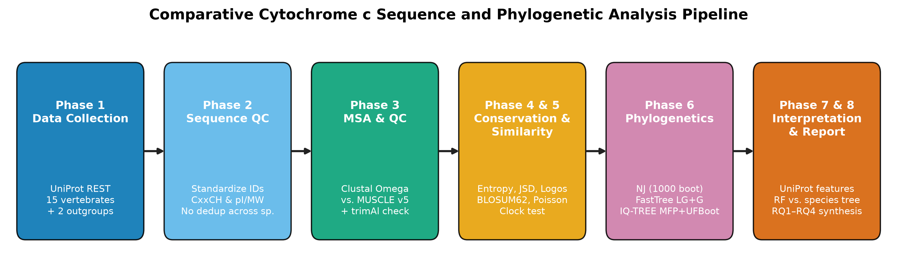

### 4.1 Data Collection and Curation (Phases 1–2)
Sequences were retrieved programmatically from the UniProtKB REST API [16] with strict filtering to retain somatic cytochrome *c* orthologs (100–112 aa for vertebrates; 100–115 aa for outgroups; standard 20 amino acids; presence of the `CxxCH` heme-binding motif; exclusion of testis-specific *Cyct* and non-somatic paralogs). Sequences were standardized to tree-safe IDs (`Genus_species`), ordered in a fixed biological sequence, and audited without cross-species deduplication so that genuine identical sequences across species are preserved. Physicochemical properties (MW, pI, GRAVY) were computed using Biopython `ProteinAnalysis` [14].

### 4.2 Multiple Sequence Alignment (Phase 3)
Both the full 17-species dataset (`all`) and the 15-vertebrate dataset (`vert`) were aligned independently using **Clustal Omega 1.2.4** [7] and **MUSCLE 5.3** [8]. Aligner concordance was quantified via informative column agreement (TC score, columns with >= 2 non-gap residues) and pairwise aligned residue-pair agreement (SP score). A trimAl v1.5 (`-gt 0.8`) [13] trimmed alignment was generated strictly for phylogenetic sensitivity testing.

### 4.3 Conservation and Similarity Analysis (Phases 4–5)
Per-column conservation was evaluated primarily on `primary_vert.fasta` (avoiding distortion from outgroup N-terminal extensions) and secondarily on `primary_all.fasta` for deep conservation. Metrics included consensus identity fraction, Shannon entropy (`H = -sum p_i log2 p_i`, unweighted, no pseudo-counts), normalized conservation score (`1 - H / log2(20)`), Jensen-Shannon divergence against BLOSUM62 background frequencies (Capra & Singh 2007 [17], window = 0, multiplied by `1 - gap_fraction`), and physico-chemical class conservation. Sequence logos were generated with Logomaker (`pseudocount=0`) [18].

Pairwise identity (`100 * identical / n_compared`), BLOSUM62 similarity (`BLOSUM62 > 0`), p-distance, and Poisson-corrected distance (`-ln(1 - p)`) were computed across all 136 species pairs from `primary_all.fasta` and cross-validated against independent global pairwise alignments (`Bio.Align.PairwiseAligner`, BLOSUM62, gap open = −10.0, gap extend = −0.5) and Clustal Omega's `--percent-id` matrix. Approximate MRCA divergence times (Mya) were tested against identity (Spearman rank correlation) and Poisson distance (OLS regression), noting non-independence of phylogenetically related pairs.

### 4.4 Phylogenetic Inference and Species-Tree Validation (Phases 6–7)
Three complementary phylogenetic methods were applied:
- **Neighbor-Joining (NJ):** Biopython NJ using Poisson distances (1,000 bootstrap replicates, seed `42`) and BLOSUM62 distances.
- **FastTree 2.2.0** [12]: Approximate ML (`-lg -gamma`, SH-like local supports).
- **IQ-TREE 3.1.4** [9]: Full ML with ModelFinder Plus (`-m MFP`) [10], 1,000 UFBoot2 (`-B 1000 -bnni`) [11], 1,000 SH-aLRT (`-alrt 1000`), `-keep-ident`, and outgroup rooting on *Saccharomyces cerevisiae*. Sensitivity variants tested vertebrate-only alignment, fixed `LG+G4`, MUSCLE alignment, trimAl-trimmed alignment, and alternative random seeds (`1`, `2`). Weak branches (`length < 1e-6` or `UFBoot < 50`) were collapsed into polytomies in `cytc_all.collapsed.nwk`.

Trees were compared quantitatively against the accepted vertebrate species tree (`config/reference_species_tree.nwk`, Laurasiatheria polytomy; Archelosauria turtle+birds) using unrooted and rooted Robinson-Foulds (RF) distances in DendroPy [15] and clade-by-clade monophyly checks. Human UniProt `P99999` functional annotations were joined programmatically with per-position conservation.

---

## 5. Results

### 5.1 Curated Dataset and Sequence QC
Seventeen verified somatic cytochrome *c* sequences were collected (13 Swiss-Prot reviewed, 4 TrEMBL vertebrates passing all somatic validation criteria; **Table T1**). Fourteen of 15 vertebrates have the modal length of 105 aa, *Danio rerio* is 104 aa (missing 1 C-terminal residue; MW 11.456 kDa), while *D. melanogaster* (108 aa, +3 aa) and *S. cerevisiae* (109 aa, +4 aa) carry N-terminal extensions (**Figure 2**). All 15 vertebrates are strongly basic (pI 9.46–9.79), contain exactly 2 heme-binding Cys residues, and carry the `CxxCH` motif at UniProt position 15 (classical 14). One identical cross-species pair was detected and retained: *Mus musculus* and *Rattus norvegicus* (105 aa, 100% identical).

**Table T1: Curated Dataset Provenance**

| species | taxon_id | accession | database | reviewed | gene_name | length |
| --- | --- | --- | --- | --- | --- | --- |
| Homo_sapiens | 9606 | P99999 | UniProt | True | CYCS | 105 |
| Macaca_mulatta | 9544 | P00002 | UniProt | True | CYCS | 105 |
| Mus_musculus | 10090 | P62897 | UniProt | True | Cycs | 105 |
| Rattus_norvegicus | 10116 | P62898 | UniProt | True | Cycs | 105 |
| Canis_lupus_familiaris | 9615 | P00011 | UniProt | True | CYCS | 105 |
| Bos_taurus | 9913 | P62894 | UniProt | True | CYCS | 105 |
| Equus_caballus | 9796 | P00004 | UniProt | True | CYCS | 105 |
| Monodelphis_domestica | 13616 | A0A5F8HEK2 | UniProt | False | LOC100010620 | 105 |
| Gallus_gallus | 9031 | P67881 | UniProt | True | CYC | 105 |
| Taeniopygia_guttata | 59729 | B5FZX0 | UniProt | False | nan | 105 |
| Anolis_carolinensis | 28377 | A0A803TKE1 | UniProt | False | LOC100560655 | 105 |
| Chrysemys_picta | 8478 | A0A8C3PCA0 | UniProt | False | LOC101947485 | 105 |
| Xenopus_tropicalis | 8364 | Q640U4 | UniProt | True | cycs | 105 |
| Danio_rerio | 7955 | Q6IQM2 | UniProt | True | cyc | 104 |
| Takifugu_rubripes | 31033 | Q1KL06 | UniProt | True | cyc-a | 105 |
| Drosophila_melanogaster | 7227 | P84029 | UniProt | True | Cyt-c-p | 108 |
| Saccharomyces_cerevisiae | 559292 | P00044 | UniProt | True | CYC1 | 109 |

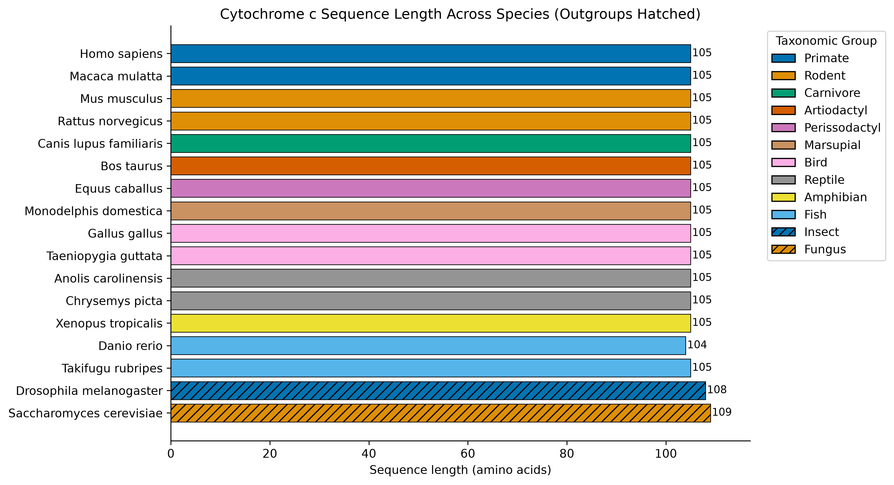

### 5.2 Multiple Sequence Alignment Quality
Clustal Omega (`primary`) and MUSCLE v5 produced highly concordant alignments (**Table T3**, **Figure 3**): **98.10%** shared informative columns (99.87% shared residue pairs) on the 15-vertebrate alignment and **96.33%** shared informative columns (99.69% shared residue pairs) on the 17-species alignment. Disagreements were confined exclusively to the N-terminal outgroup extension (cols 2–3) and the 1-aa C-terminal truncation (cols 109–110). Zero internal gaps occurred anywhere in the primary alignment; `CxxCH` aligned gap-free at cols 20–24 (`primary_all`) / 15–19 (`primary_vert`), and the Met80 loop (classical 70–85; UniProt 71–86) was completely gap-free.

**Table T3: Multiple Sequence Alignment Statistics**

| alignment | dataset | aligner | n_seq | aln_length | n_gap_columns | n_gapfree_columns | n_invariant_columns | pct_identity_columns | mean_pairwise_identity | total_gap_chars | n_gap_blocks | sum_of_pairs_blosum62 |
| --- | --- | --- | --- | --- | --- | --- | --- | --- | --- | --- | --- | --- |
| all_clustalo | all | clustalo | 17 | 110 | 6 | 104 | 52 | 47.27 | 84.65 | 79 | 19 | 65030.5 |
| all_muscle | all | muscle | 17 | 110 | 6 | 104 | 52 | 47.27 | 84.71 | 79 | 19 | 65088.5 |
| vert_clustalo | vert | clustalo | 15 | 105 | 1 | 104 | 67 | 63.81 | 88.73 | 1 | 1 | 52941.0 |
| vert_muscle | vert | muscle | 15 | 105 | 1 | 104 | 67 | 63.81 | 88.68 | 1 | 1 | 52913.0 |
| primary_all_trimmed | all_trimmed | clustalo+trimal | 17 | 105 | 1 | 104 | 52 | 49.52 | 84.67 | 3 | 3 | 65398.0 |

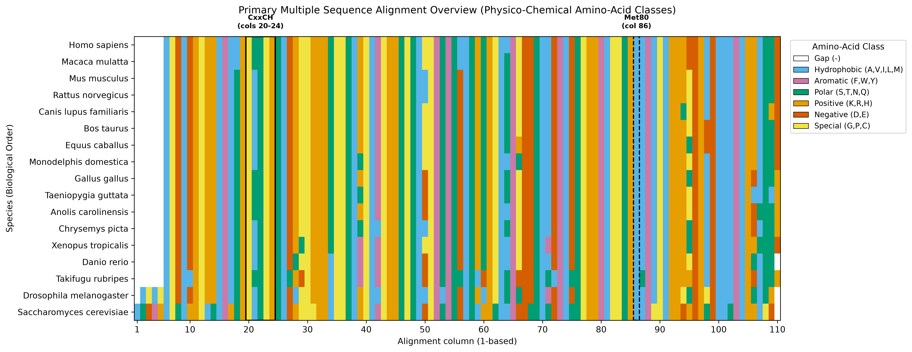

### 5.3 Sequence Conservation and Conserved Regions (RQ1 & RQ2)
Vertebrate cytochrome *c* is highly conserved (**Figure 4**, **Figure 5**): **67 / 105 (63.81%)** columns are strictly invariant, **83 / 105 (79.05%)** are >= 90% conserved, mean identity is **92.99%**, and mean Shannon entropy is **0.2741 bits**. Adding *D. melanogaster* and *S. cerevisiae* retains **52 / 67 (77.6%)** of vertebrate-invariant sites as strictly invariant across all 17 species (**47.27%** of 110 columns). Twelve conserved regions (>= 3 aa) and one C-terminal variable region (UniProt 104–105, classical 103–104) were detected. The longest conserved region spans **17 aa** (`EYLENPKKYIPGTKMIF`, UniProt 67–83 / classical 66–82), housing the longest strictly invariant stretch of **11 aa** (`NPKKYIPGTKM`, UniProt 71–81 / classical 70–80, encompassing the Met80 loop).

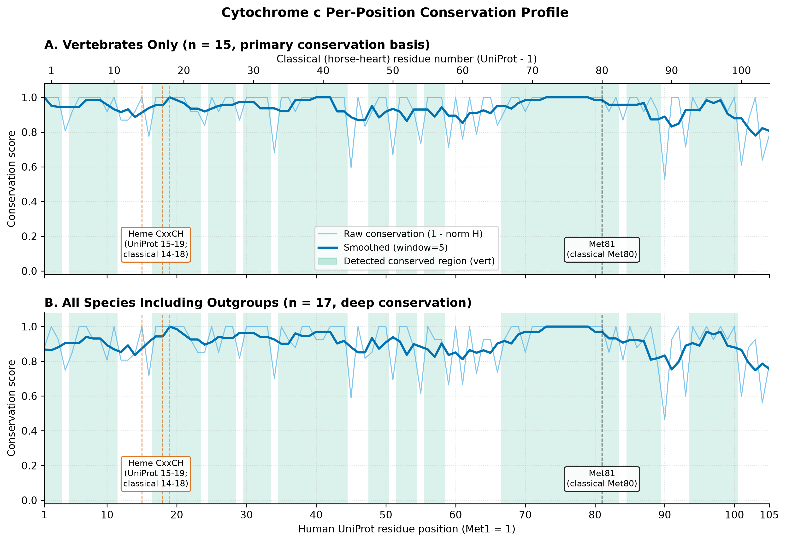

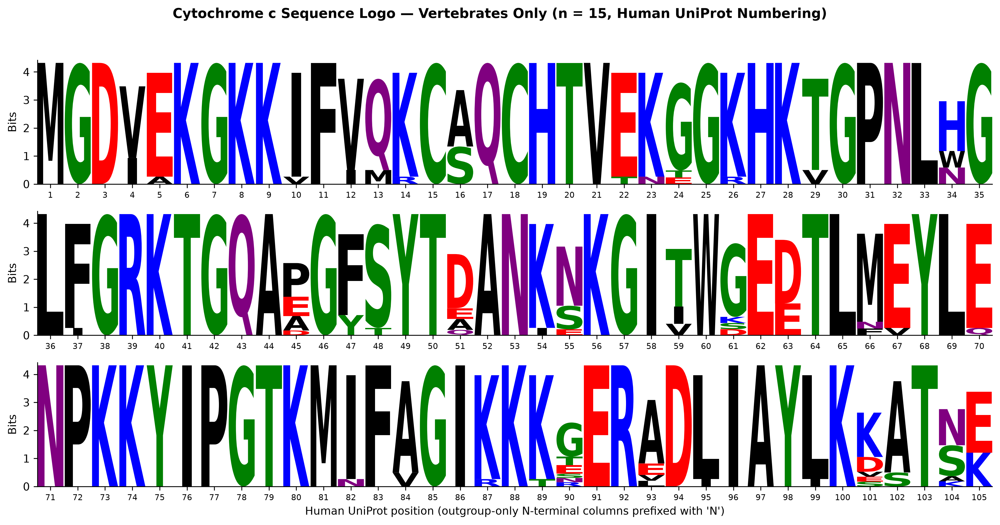

### 5.4 Pairwise Sequence Similarity and Molecular Clock (RQ3)
MSA-derived pairwise identities agreed tightly with independent global `PairwiseAligner` alignments (`r = 0.9990`, max difference `1.92%`, 0 pairs > 2%) and Clustal Omega's `--percent-id` matrix (`r = 0.9998`). Pairwise identity followed a clear evolutionary gradient (**Figure 6**, **Figure 7**, **Table T5**): mean identity within mammals (**93.61%**) > mammal vs. bird (**90.89%**) > mammal vs. fish (**80.78%**) > vertebrate vs. yeast (**61.41%**).

**Table T5: Pairwise Sequence Identity and Distance to *Homo sapiens***

| species | group | clade | identity_pct | similarity_pct | n_substitutions | poisson_distance | mya_divergence |
| --- | --- | --- | --- | --- | --- | --- | --- |
| Homo_sapiens | Primate | Mammal | 100.0 | 100.0 | 0 | 0.0 | 0.0 |
| Macaca_mulatta | Primate | Mammal | 99.05 | 99.05 | 1 | 0.0096 | 29.0 |
| Mus_musculus | Rodent | Mammal | 91.43 | 94.29 | 9 | 0.0896 | 90.0 |
| Rattus_norvegicus | Rodent | Mammal | 91.43 | 94.29 | 9 | 0.0896 | 90.0 |
| Bos_taurus | Artiodactyl | Mammal | 90.48 | 94.29 | 10 | 0.1001 | 94.0 |
| Monodelphis_domestica | Marsupial | Mammal | 90.48 | 95.24 | 10 | 0.1001 | 160.0 |
| Canis_lupus_familiaris | Carnivore | Mammal | 89.52 | 93.33 | 11 | 0.1107 | 94.0 |
| Equus_caballus | Perissodactyl | Mammal | 88.57 | 93.33 | 12 | 0.1214 | 94.0 |
| Taeniopygia_guttata | Bird | Bird | 88.57 | 92.38 | 12 | 0.1214 | 320.0 |
| Gallus_gallus | Bird | Bird | 87.62 | 92.38 | 13 | 0.1322 | 320.0 |
| Anolis_carolinensis | Reptile | Reptile | 87.62 | 94.29 | 13 | 0.1322 | 320.0 |
| Xenopus_tropicalis | Amphibian | Amphibian | 86.67 | 93.33 | 14 | 0.1431 | 352.0 |
| Chrysemys_picta | Reptile | Reptile | 84.76 | 92.38 | 16 | 0.1653 | 320.0 |
| Danio_rerio | Fish | Fish | 84.62 | 91.35 | 16 | 0.1671 | 430.0 |
| Drosophila_melanogaster | Insect | Insect | 76.92 | 83.65 | 24 | 0.2624 | 780.0 |
| Takifugu_rubripes | Fish | Fish | 71.43 | 82.86 | 30 | 0.3365 | 430.0 |
| Saccharomyces_cerevisiae | Fungus | Fungus | 62.5 | 75.0 | 39 | 0.47 | 1100.0 |

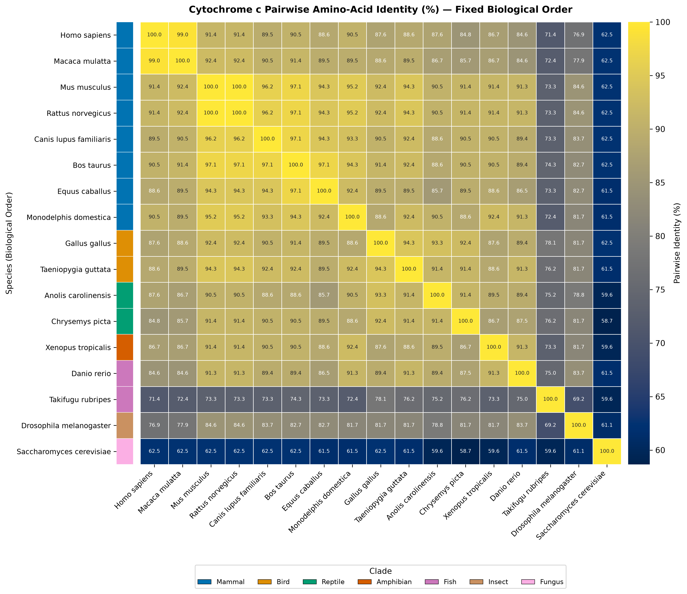

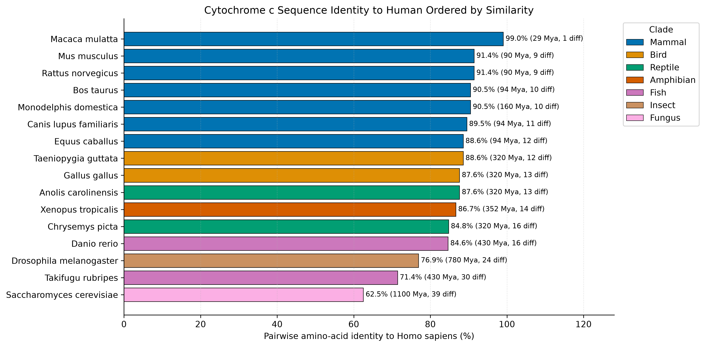

Sequence identity declined strongly with approximate divergence time (human-vs-X Spearman `rho = −0.958`; all 136 pairs `rho = −0.832`), and Poisson evolutionary distance scaled linearly with time (`R² = 0.815`, slope = `0.352` substitutions/site/Gyr for human-vs-X; **Figure 8**). However, pronounced rate heterogeneity appeared in *Takifugu rubripes* (`cyc-a`, residual `+0.136`, 30 differences from human vs. 16 for *Danio rerio*), making *Homo sapiens* vs. *Takifugu rubripes* (71.43%) the least similar vertebrate pair.

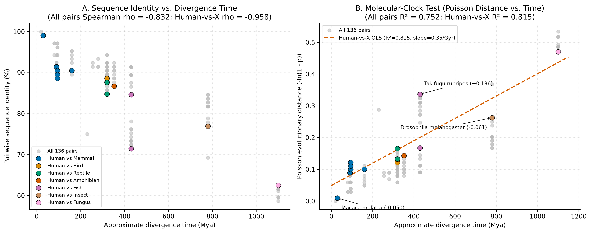

### 5.5 Phylogenetic Reconstruction and Sensitivity Analysis
IQ-TREE ModelFinder Plus selected **`Q.YEAST+G4`** (log-likelihood `-999.94`, BIC `2150.30`, total tree length `2.40` subs/site; **Figure 9**). Rooted on *S. cerevisiae*, *D. melanogaster* branched outside Vertebrata (SH-aLRT / UFBoot = `89.9 / 70`), and Primates formed a strongly supported clade (`98.9 / 100`). However, only **2 / 15** internal ML nodes met joint strong support (`UFBoot >= 70` and `SH-aLRT >= 80`), and **7** weakly supported or near-zero branches collapsed into polytomies in `cytc_all.collapsed.nwk`. *M. musculus* and *R. norvegicus* had a patristic distance of `2e-6` (`0 / 94`), confirming arbitrary internal resolution of identical sequences.

Across 9 sensitivity variants (NJ Poisson, NJ BLOSUM62, FastTree, vertebrate-only ML, fixed `LG+G4`, MUSCLE ML, trimmed ML, seeds 1 & 2; **Figure 10**), four splits were 100% stable (`{Bos, Equus}`, `{Mus, Rattus}`, `{Danio, Xenopus}`, `{Bos, Canis, Equus}`), `{Homo, Macaca}` appeared in 8/9 variants, while deep internal splits varied substantially (unrooted RF `2–18` vs. primary ML).

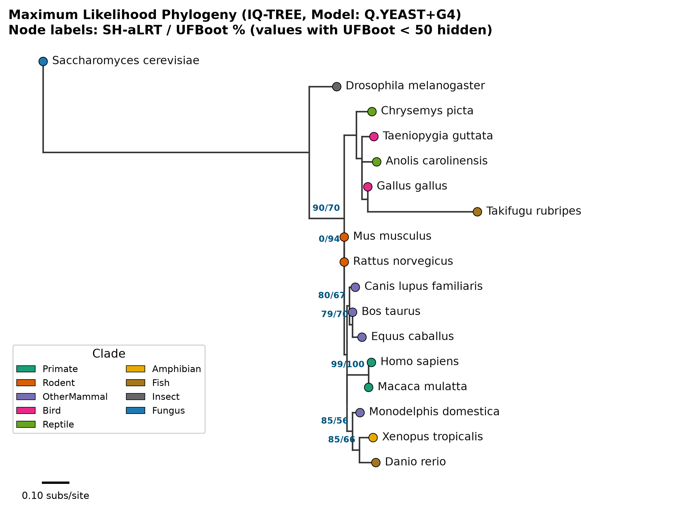

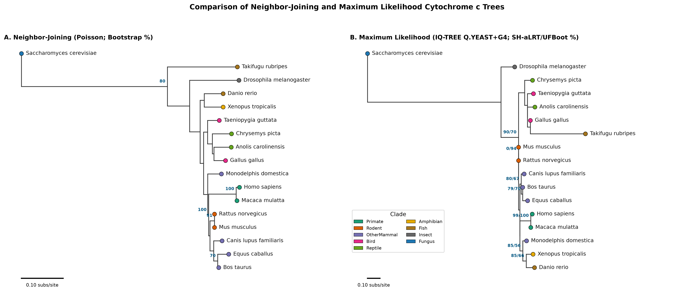

### 5.6 Agreement with the Accepted Vertebrate Species Tree (RQ4)
Comparison against the accepted species tree (`config/reference_species_tree.nwk`; **Figure 11**, **Tables T8 & T8b**) revealed limited single-gene phylogenetic resolution. Only **19 / 105** vertebrate columns (27 / 110 all-17) are parsimony-informative. Primary ML recovered **5 / 14** reference clades (unrooted RF = **19**; normalized **0.68**), dropping to RF = **12** when unsupported branches were collapsed. NJ Poisson recovered **8 / 14** clades (RF = **13**), including Mammalia, Eutheria, Sauropsida, and Amniota (mostly with low bootstrap `21–27%`), but pulled fast-evolving *Takifugu rubripes* outside *Drosophila*, breaking Vertebrata. In ML, *Takifugu rubripes* nested inside Sauropsida (low UFBoot `43–49%`), disrupting Teleostei, Aves, and Sauropsida.

**Table T8b: Robinson-Foulds Distances vs. Reference Species Tree**

| tree | unrooted_rf | norm_unrooted_rf | rooted_rf | norm_rooted_rf | ref_clades_recovered | total_ref_clades | pct_ref_clades_recovered |
| --- | --- | --- | --- | --- | --- | --- | --- |
| ML (IQ-TREE primary) | 19 | 0.6786 | 19 | 0.6333 | 5 | 14 | 35.7 |
| ML (IQ-TREE collapsed) | 12 | 0.4286 | 12 | 0.4 | 5 | 14 | 35.7 |
| NJ (Poisson) | 13 | 0.4643 | 13 | 0.4333 | 8 | 14 | 57.1 |
| NJ (BLOSUM62) | 11 | 0.3929 | 11 | 0.3667 | 9 | 14 | 64.3 |
| FastTree (LG+G) | 21 | 0.75 | 21 | 0.7 | 4 | 14 | 28.6 |

**Table T8: Clade-by-Clade Monophyly Recovery**

| clade | n_members | recovered_in_ML | UFBoot | recovered_in_NJ | NJ_bootstrap | recovered_in_FastTree | FastTree_SH_pct |
| --- | --- | --- | --- | --- | --- | --- | --- |
| Mammalia | 8 | N | nan | Y | 22.4 | N | nan |
| Eutheria | 7 | N | nan | Y | 100.0 | N | nan |
| Primates | 2 | Y | 100.0 | Y | 99.8 | Y | 100.0 |
| Rodentia | 2 | Y | 94.0 | Y | 91.1 | Y | nan |
| Euarchontoglires | 4 | N | nan | N | nan | N | nan |
| Laurasiatheria | 3 | Y | 67.0 | Y | 49.1 | Y | 80.3 |
| Aves | 2 | N | nan | N | nan | N | nan |
| Sauropsida | 4 | N | nan | Y | 26.7 | N | nan |
| Amniota | 12 | N | nan | Y | 20.6 | N | nan |
| Tetrapoda | 13 | N | nan | N | nan | N | nan |
| Teleostei | 2 | N | nan | N | nan | N | nan |
| Vertebrata | 15 | Y | 70.0 | N | nan | N | nan |
| Bilateria | 16 | Y | nan | Y | 80.5 | Y | 85.2 |

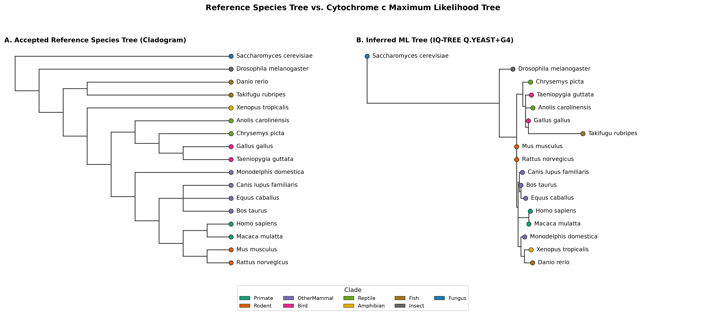

### 5.7 Functional Interpretation of Conserved and Variable Sites
Mapping UniProt `P99999` annotations and the literature functional checklist onto our alignment (**Figure 12**, **Table T9**) showed that every core structural and catalytic residue is strictly invariant across all 17 species: covalent heme attachment cysteines (Cys15, Cys18; cl. 14, 17), axial heme ligands (His19, Met81; cl. 18, 80), heme-pocket H-bond residues (Asn53, Trp60, Tyr68, Thr79; cl. 52, 59, 67, 78), tight packing sites (Gly7, Pro31, Gly42, Phe83; cl. 6, 30, 41, 82), five core lysine-patch residues (Lys28, 73, 74, 80, 88; cl. 27, 72, 73, 79, 87), both regulatory phosphosites (Tyr49, Tyr98; cl. 48, 97), and the pathogenic Thrombocytopenia 4 variant site **Gly42Ser** (cl. Gly41, `rs121918552`). By contrast, the 10 most variable vertebrate sites (led by UniProt 90 / cl. 89 at 2.04 bits and C-terminal residues 101–105) have predominantly negative Kyte-Doolittle hydropathy, consistent with solvent-exposed surface positions under relaxed constraint. Five diagnostic primate-specific substitutions (`I12`, `M13`, `A51`, `V84`, `E90` UniProt; classical `11, 12, 50, 83, 89`) distinguish *Homo sapiens* and *Macaca mulatta* from all other sampled vertebrates, consistent with primate-lineage remodeling reported by Pierron et al. [3].

**Table T9: Functional Checklist Verification**

| feature | classical_pos | uniprot_pos | human_residue | vert_class | vert_residue_counts | all17_residue_counts | supports_expected_role |
| --- | --- | --- | --- | --- | --- | --- | --- |
| Heme covalent attachment (thioether) | 14 | 15 | C | invariant | C:15 | C:17 | yes |
| Heme covalent attachment (thioether) | 17 | 18 | C | invariant | C:15 | C:17 | yes |
| Proximal axial heme ligand | 18 | 19 | H | invariant | H:15 | H:17 | yes |
| Distal axial heme ligand | 80 | 81 | M | invariant | M:15 | M:17 | yes |
| Heme pocket H-bond network | 52 | 53 | N | invariant | N:15 | N:17 | yes |
| Heme pocket H-bond network | 59 | 60 | W | invariant | W:15 | W:17 | yes |
| Heme pocket H-bond network | 67 | 68 | Y | invariant | Y:15 | Y:17 | yes |
| Heme pocket H-bond network | 78 | 79 | T | invariant | T:15 | T:17 | yes |
| Close packing around heme | 6 | 7 | G | invariant | G:15 | G:17 | yes |
| Close packing around heme | 30 | 31 | P | invariant | P:15 | P:17 | yes |
| Close packing around heme | 41 | 42 | G | invariant | G:15 | G:17 | yes |
| Close packing around heme | 82 | 83 | F | invariant | F:15 | F:17 | yes |
| Lysine patch (partner docking) | 13 | 14 | K | highly_conserved | K:14, R:1 | K:14, R:3 | partly |
| Lysine patch (partner docking) | 27 | 28 | K | invariant | K:15 | K:17 | yes |
| Lysine patch (partner docking) | 72 | 73 | K | invariant | K:15 | K:17 | yes |
| Lysine patch (partner docking) | 73 | 74 | K | invariant | K:15 | K:17 | yes |
| Lysine patch (partner docking) | 79 | 80 | K | invariant | K:15 | K:17 | yes |
| Lysine patch (partner docking) | 86 | 87 | K | highly_conserved | K:14, R:1 | K:16, R:1 | partly |
| Lysine patch (partner docking) | 87 | 88 | K | invariant | K:15 | K:17 | yes |
| Regulatory phosphosite (human) | 48 | 49 | Y | invariant | Y:15 | Y:17 | yes |
| Regulatory phosphosite (human) | 97 | 98 | Y | invariant | Y:15 | Y:17 | yes |
| Disease variant (UniProt Natural variant) | 41 | 42 | G | invariant | G:15 | G:17 | yes |
| Disease variant (UniProt Natural variant) | 55 | 56 | K | invariant | K:15 | K:17 | yes |
| Disease variant (UniProt Natural variant) | 65 | 66 | M | moderately_conserved | M:13, F:1, N:1 | M:13, F:2, N:1, S:1 | partly |

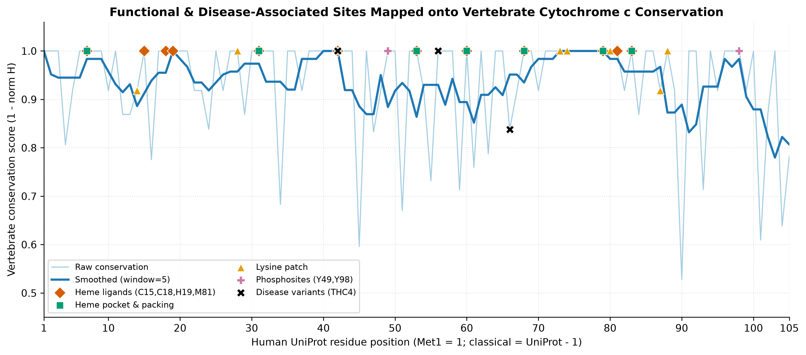

---

## 6. Discussion

- **RQ1 (Conservation):** Cytochrome *c* is extraordinarily conserved across vertebrates (63.8% invariant, 79.1% >= 90% conserved, mean entropy 0.274 bits), with 77.6% of vertebrate-invariant sites preserved even in fly and yeast.
- **RQ2 (Conserved regions & sites):** Extreme conservation concentrates in the `CxxCH` heme-attachment motif (UniProt 15–19), the 11-aa invariant Met80 loop (`NPKKYIPGTKM`, UniProt 71–81), heme-pocket H-bond/packing residues, the electrostatic lysine patch, and regulatory Tyr49/Tyr98. Variability is largely confined to hydrophilic surface loops and the C-terminus.
- **RQ3 (Similarity vs. distance):** Pairwise identity strongly mirrors evolutionary relatedness (human-vs-X Spearman `rho = −0.958`, Poisson clock `R² = 0.815`), though rate heterogeneity is evident in *Takifugu rubripes* and in the primate stem lineage.
- **RQ4 (Phylogenetic utility):** Cytochrome *c* alone is **insufficient** to reconstruct the full vertebrate species tree robustly. With only 19 parsimony-informative vertebrate sites, deep internodes have minimal signal, identical sequences produce zero-length branches, and accelerated evolution in *Takifugu rubripes* causes long-branch attraction.
- **Hypothesis Verdict:** **Partially supported.** Closely related species consistently show higher pairwise similarity (99–100% within primates and rodents vs. 61–62% to yeast), but phylogenetic clustering recovers only a subset of accepted vertebrate clades (5/14 in ML, 8–9/14 in NJ) with low support at most internal nodes.

---

## 7. Limitations and Future Work

### 7.1 Limitations
1. **Single short protein (~105 aa) with limited phylogenetic signal:** Cytochrome c is extremely conserved (63.8% invariant in vertebrates), leaving only **19** parsimony-informative sites in vertebrates (27 across all 17 species). Consequently, 13 of 15 internal ML nodes lack strong joint support (`UFBoot >= 70` and `SH-aLRT >= 80`), and 7 branches collapse into polytomies when unsupported splits are removed.
2. **Small, uneven taxon sampling:** Only 15 vertebrate species (one sequence per species) represent major classes, with mammals overrepresented (8 species) relative to amphibians (1 species) and fishes (2 teleosts, no cartilaginous or jawless fish).
3. **Identical sequences and zero-length branches:** *Mus musculus* and *Rattus norvegicus* have 100% identical somatic cytochrome c sequences (patristic distance `2e-6`), making their internal resolution arbitrary and preventing resolution of shallow splits.
4. **Lineage-specific rate heterogeneity and long-branch effects:** *Takifugu rubripes* (`cyc-a`) exhibits accelerated divergence (+0.136 Poisson residual above the molecular-clock line; 30 differences from human vs. 16 for *Danio rerio*), inducing long-branch attraction that disrupts Teleostei, Sauropsida (in ML), and Vertebrata (in NJ). Similarly, the 5 primate-specific substitutions lengthen the primate stem branch relative to other mammals.
5. **Database-derived annotations and potential paralog effects:** Four vertebrate sequences (*M. domestica*, *T. guttata*, *A. carolinensis*, *C. picta*) were retrieved from UniProt TrEMBL (unreviewed) because reviewed Swiss-Prot entries were unavailable, and teleosts underwent whole-genome duplication (so *Takifugu* `cyc-a` may reflect relaxed constraint on a teleost duplicate).
6. **Deep outgroup divergence:** *Saccharomyces cerevisiae* (~1.1 Gya divergence, 4-aa N-terminal extension, ~61% identity to vertebrates) sits on a very long root branch (`1.06` subs/site in ML), which can attract long ingroup branches. Cross-checks using *Drosophila melanogaster* and the unrooted vertebrate-only tree (`cytc_vert`, pruned RF = 4 vs. primary ML) confirmed that vertebrate internal instability persists even without outgroups.
7. **Approximate divergence times and non-independence of pairwise tests:** Divergence times in the molecular-clock analysis are approximate consensus node ages (Mya) rather than calibrated fossil priors, and pairwise species comparisons are statistically non-independent due to shared phylogenetic ancestry (making correlation p-values descriptive only).
8. **Gene tree vs. species tree:** A single nuclear-encoded mitochondrial protein gene tree need not match the organismal species tree because of incomplete lineage sorting, convergent functional substitutions, or lineage-specific selection on mitochondrial electron transport.
9. **Computational-only scope:** No wet-lab biochemical assays or 3D structural dynamics simulations were performed; surface exposure of variable sites was inferred from sequence hydropathy rather than solvent-accessible surface area or mutagenesis experiments.

### 7.2 Future Work
Future extensions should concatenate somatic *CYCS* with additional conserved mitochondrial and nuclear markers (e.g., *COX1*, *CYTB*, *ND1*), expand taxonomic sampling (adding cartilaginous fishes, lampreys, and additional amphibians/non-anthropoid primates), perform Bayesian phylogenetic inference (MrBayes/BEAST) with fossil-calibrated relaxed clocks, analyze codon-level `dN/dS` selection with HyPhy/PAML, and map conservation onto 3D crystal structures (e.g., PDB `3ZCF`) using solvent-accessible surface area calculations.

---

## 8. Conclusion

Somatic cytochrome *c* exhibits remarkable evolutionary stability across vertebrates and deep eukaryotes, with strict invariance locking in the heme-coordination core, Met80 loop, electrostatic docking lysines, regulatory phosphosites, and pathogenic Thrombocytopenia 4 site Gly42 (cl. 41). While pairwise sequence identity tracks evolutionary divergence times closely (`rho = −0.958`), the very conservation that protects cytochrome *c* function restricts its single-gene phylogenetic resolving power to 19 parsimony-informative vertebrate sites, yielding low internal branch support and susceptibility to long-branch attraction in fast-evolving lineages such as *Takifugu rubripes*. Multi-gene phylogenomic datasets remain essential for resolving vertebrate species trees.

---

## 9. References

[1] W. M. Fitch, "The molecular evolution of cytochrome c in eukaryotes," *Journal of Molecular Evolution*, vol. 8, no. 1, pp. 13–40, 1976.  
[2] M. Syvanen, H. Hartman, and P. F. Stevens, "Classical plant taxonomic ambiguities extend to the molecular level," *Journal of Molecular Evolution*, vol. 28, no. 6, pp. 536–544, 1989.  
[3] D. Pierron, J. C. Opazo, M. Heiske, Z. Papper, M. Uddin, G. Chand, D. E. Wildman, R. Romero, M. Goodman, and L. I. Grossman, "Silencing, positive selection and parallel evolution: busy history of primate cytochromes c," *PLoS ONE*, vol. 6, no. 10, p. e26269, 2011.  
[4] A. De Grassi, C. Lanave, and C. Saccone, "Evolution of ATP synthase subunit c and cytochrome c gene families in selected Metazoan classes," *Gene*, vol. 371, no. 2, pp. 224–233, 2006.  
[5] E. Margoliash, "Primary structure and evolution of cytochrome c," *Proc. Natl. Acad. Sci. U.S.A.*, vol. 50, no. 4, pp. 672–679, 1963.  
[6] W. M. Fitch and E. Margoliash, "Construction of phylogenetic trees," *Science*, vol. 155, no. 3760, pp. 279–284, 1967.  
[7] F. Sievers et al., "Fast, scalable generation of high-quality protein multiple sequence alignments using Clustal Omega," *Molecular Systems Biology*, vol. 7, p. 539, 2011.  
[8] R. C. Edgar, "Muscle5: High-accuracy alignment ensembles enable unbiased assessments of sequence homology and phylogeny," *Nature Communications*, vol. 13, p. 6968, 2022.  
[9] B. Q. Minh et al., "IQ-TREE 2: New models and efficient methods for phylogenetic inference in the genomic era," *Molecular Biology and Evolution*, vol. 37, no. 5, pp. 1530–1534, 2020.  
[10] S. Kalyaanamoorthy, B. Q. Minh, T. K. F. Wong, A. von Haeseler, and L. S. Jermiin, "ModelFinder: fast model selection for accurate phylogenetic estimates," *Nature Methods*, vol. 14, pp. 587–589, 2017.  
[11] D. T. Hoang, O. Chernomor, A. von Haeseler, B. Q. Minh, and L. S. Vinh, "UFBoot2: Improving the ultrafast bootstrap approximation," *Molecular Biology and Evolution*, vol. 35, no. 2, pp. 518–522, 2018.  
[12] M. N. Price, P. S. Dehal, and A. P. Arkin, "FastTree 2 – approximately maximum-likelihood trees for large alignments," *PLoS ONE*, vol. 5, no. 3, p. e9490, 2010.  
[13] S. Capella-Gutiérrez, J. M. Silla-Martínez, and T. Gabaldón, "trimAl: a tool for automated alignment trimming in large-scale phylogenetic analyses," *Bioinformatics*, vol. 25, no. 15, pp. 1972–1973, 2009.  
[14] P. J. A. Cock et al., "Biopython: freely available Python tools for computational molecular biology and bioinformatics," *Bioinformatics*, vol. 25, no. 11, pp. 1422–1423, 2009.  
[15] J. Sukumaran and M. T. Holder, "DendroPy: a Python library for phylogenetic computing," *Bioinformatics*, vol. 26, no. 12, pp. 1569–1571, 2010.  
[16] The UniProt Consortium, "UniProt: the Universal Protein Knowledgebase in 2023," *Nucleic Acids Research*, vol. 51, no. D1, pp. D523–D531, 2023.  
[17] J. A. Capra and M. Singh, "Predicting functionally important residues from sequence conservation," *Bioinformatics*, vol. 23, no. 15, pp. 1875–1882, 2007.  
[18] A. Tareen and J. B. Kinney, "Logomaker: beautiful sequence logos in Python," *Bioinformatics*, vol. 36, no. 7, pp. 2272–2274, 2020.  

---

## 10. Appendix: Reproducibility and Supplementary Assets

- **Reproducibility:** Create the environment with `mamba env create -f environment.yml && conda activate cytc`, then run `make phase1-offline phase2 phase3 phase4 phase5 phase6 phase7 phase8 && pytest -q` (or `make all` to re-fetch from UniProt).
- **Full tables & matrices:** `report/tables/` (`T1`–`T9`), `results/similarity/*_matrix.csv`, `results/conservation/per_position_*.csv`, `results/tables/reproducibility_check.csv`.
- **Software versions:** `report/software_versions.md` and `environment.lock.yml`.
- **Citation audit & deliverables checklist:** `report/citation_audit.md` and `report/deliverables_checklist.md`.
